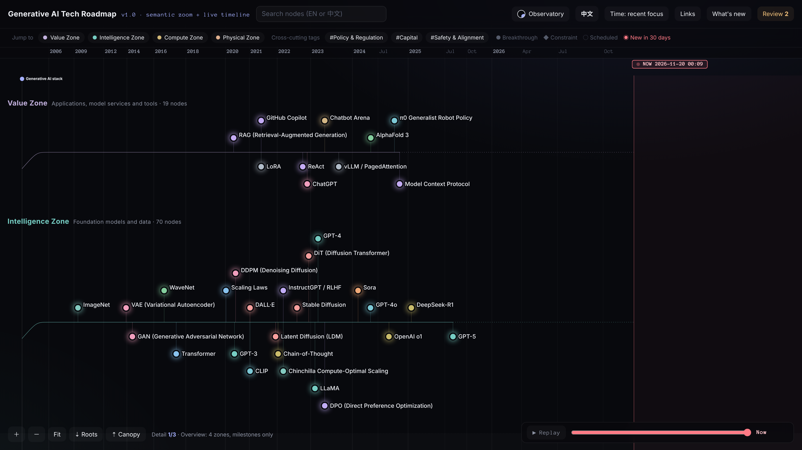
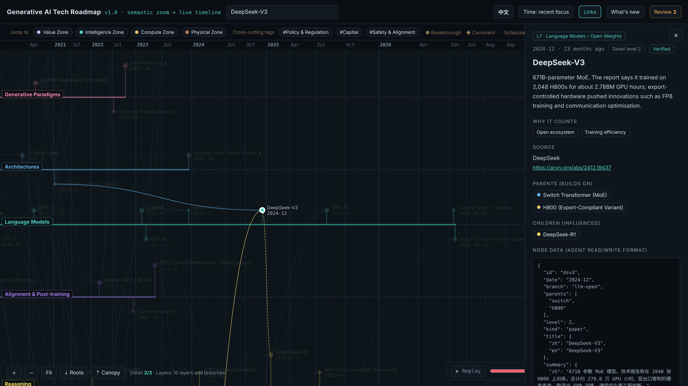
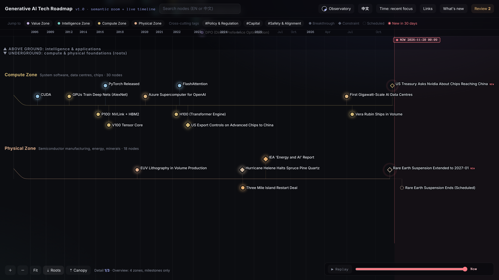

<div align="center">

# Generative AI Tech Roadmap

**An interactive map of generative AI, from the minerals and energy underneath it to the applications on top, on a live timeline.**

[生成式 AI 技术路线树](https://seamys.github.io/ai-tech-tree/#zh) · [Live demo](https://seamys.github.io/ai-tech-tree/#en) · [Contribute a node](https://github.com/seamys/ai-tech-tree/issues/new?template=new-node.yml)

[](https://github.com/seamys/ai-tech-tree/actions/workflows/pages.yml)
[](https://seamys.github.io/ai-tech-tree/)
[](data/nodes.json)
[](https://seamys.github.io/ai-tech-tree/#en)
[](https://github.com/seamys/ai-tech-tree/commits/main)

[](LICENSE)
[](data/LICENSE)
[](https://react.dev)
[](https://www.typescriptlang.org)
[](https://esbuild.github.io)
[](CONTRIBUTING.md)

<a href="https://seamys.github.io/ai-tech-tree/"></a>

</div>

## Why

Most AI timelines list models. But what is possible in generative AI also depends on chips, packaging, power plants, rare earths and export rules. Those constraints rarely show up next to the breakthroughs they shaped.

This project puts everything on one tree:
- **Breakthroughs** grow upward as branches.
- **Physical foundations** spread below a ground line as roots.
- **Edges** link causes to effects across layers. One example: *US export controls → H800 → DeepSeek-V3 → DeepSeek-R1*.

## Features

| | |
| --- | --- |
| **10 layers, 4 zones** | Value (applications, model services) · Intelligence (foundation models, data) · Compute (software, data centres, chips) · Physical (fabrication, energy, minerals) |
| **Semantic zoom** | Overview → layers and branches → sub-branches. Zooming in reveals finer detail; the timescale refines from years to months. |
| **Live timeline** | Log-scaled "recent focus" axis (or linear); a real-time "now" line; nodes from the last 30 days pulse; scheduled future events sit right of "now"; replay the tree's growth since 2010. |
| **Breakthroughs and constraints** | ● papers, releases, events · ◆ export controls, capacity shortages, power limits, lawsuits |
| **Built for review** | Every node carries sources and "why it counts" criteria; agent-proposed nodes wait in a review queue. |
| **Focus areas** | Pick a lens on first visit (the LLM race, creative and multimodal, compute and chips, energy, policy…), then fine-tune from **Focus** in the header. Other areas are dimmed or hidden. The choice is remembered, and the URL is shareable, e.g. `?focus=energy&fmode=hide`. |
| **Where it happened** | Opening a node turns a small globe to where it happened. Policies and supply shocks draw an arc from origin to the places they hit, such as Washington → China or Spruce Pine → Asian fabs. |
| **Four themes** | Observatory (default), Atlas, Blueprint and Mission Control. Pick one from the header; it is remembered per device. |
| **Bilingual** | 中文 / English for interface and content. Toggle top-right, or open `#zh` / `#en`. |

<table>
  <tr>
    <td width="50%"></td>
    <td width="50%"></td>
  </tr>
  <tr>
    <td align="center"><sub>Detail level 2 with dependency links</sub></td>
    <td align="center"><sub>The roots: chips, fabs, energy and minerals</sub></td>
  </tr>
</table>

## Quick start

```bash
git clone https://github.com/seamys/ai-tech-tree.git
cd ai-tech-tree
npm install
npm run dev        # http://localhost:5173 (rebuilds on change)
```

| Script | What it does |
| --- | --- |
| `npm run dev` | Dev server with watch mode |
| `npm run build` | Production build into `dist/` (hashed assets, data version stamp, badges) |
| `npm run validate` | Checks `data/` against the schema and cross-file rules |
| `npm run typecheck` | TypeScript, strict mode |
| `npm run check` | `validate` + `typecheck`, the same as CI |

Requires Node.js 22+. CI uses the version in [`.nvmrc`](.nvmrc).

## Project structure

```
data/                     content (CC BY 4.0), fetched at runtime
├── taxonomy.json         zones, layers, branches, tags, criteria, focus lenses
├── nodes.json            one node per line, readable diffs
├── geo/land-110m.json    Natural Earth land outlines for the globe
└── schema/               JSON Schema for nodes
src/                      app (MIT)
├── lib/time.ts           linear and "recent focus" time scales
├── lib/layout.ts         pure layout: data + zoom level → positions
├── components/           canvas, panels, header, controls
├── themes.ts             theme registry + OKLCH palette remapping
├── styles.css            design tokens and [data-theme] overrides
└── i18n.ts               interface strings
scripts/
├── build.mjs             esbuild bundle + static output
└── validate.mjs          data checks, run before every deploy
```

Data and code are separate: adding a node never touches `src/`. Design and performance notes are in [docs/ARCHITECTURE.md](docs/ARCHITECTURE.md).

## The data model

```jsonc
{
  "id": "dsv3", "date": "2024-12", "branch": "llm-open", "parents": ["switch", "h800"],
  "level": 2,                 // 1 milestone · 2 important · 3 detail
  "kind": "paper",            // paper · release · event · constraint · upcoming
  "title":   { "zh": "DeepSeek-V3", "en": "DeepSeek-V3" },
  "summary": { "zh": "…", "en": "…" },
  "source": "DeepSeek", "url": "https://arxiv.org/abs/2412.19437",
  "criteria": ["open-ecosystem", "training-efficiency"],
  "geo": [{ "lat": 30.27, "lon": 120.16, "place": { "zh": "杭州", "en": "Hangzhou" } }],
  "status": "verified"        // or "candidate" (agent-proposed, awaiting review)
}
```

Full contract: [`data/schema/node.schema.json`](data/schema/node.schema.json).

## Contributing

Corrections and new nodes are very welcome. Every fact needs a primary source. See [CONTRIBUTING.md](CONTRIBUTING.md), then open a [new node](https://github.com/seamys/ai-tech-tree/issues/new?template=new-node.yml) or [data correction](https://github.com/seamys/ai-tech-tree/issues/new?template=data-correction.yml) issue, or send a pull request.

## Roadmap

- [x] Bilingual tree with 10 layers, semantic zoom and a live timeline
- [x] Data/code split with schema validation in CI
- [x] Globe showing where each event happened
- [x] Focus areas with lenses, dim/hide and shareable URLs
- [ ] Full-screen map view with replay
- [ ] Scheduled agent that proposes candidate nodes from arXiv, vendor announcements, IEA and export-control notices
- [ ] Weekly digest notifications for subscribed branches
- [ ] Permalinks to individual nodes
- [ ] Wider coverage of 2025–2026 and of the application layer

## License

- **Code:** [MIT](LICENSE)
- **Data** (`data/`): [CC BY 4.0](data/LICENSE). Reuse is free with attribution.

If you use the dataset in research, please cite it with [CITATION.cff](CITATION.cff) (GitHub's "Cite this repository" button).
